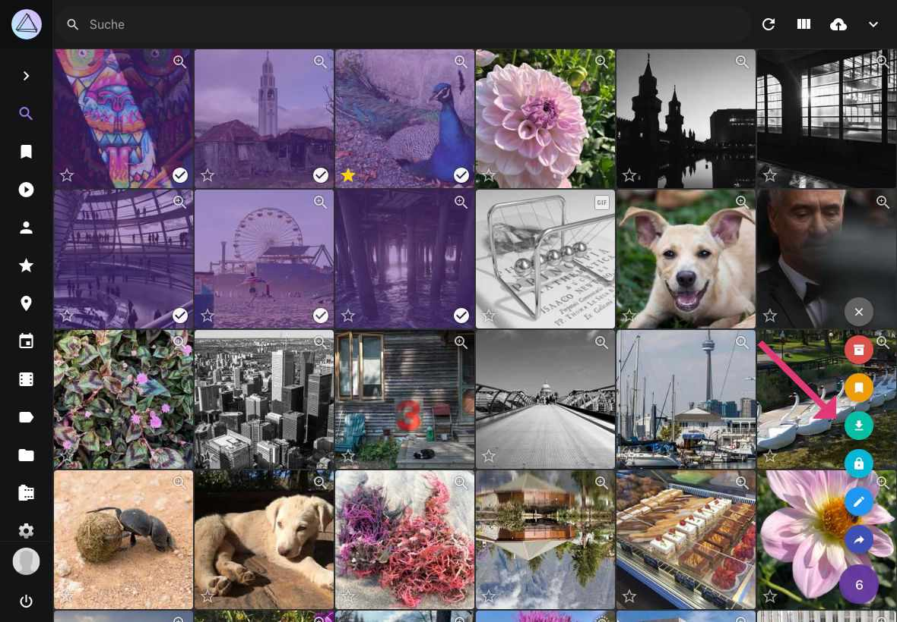
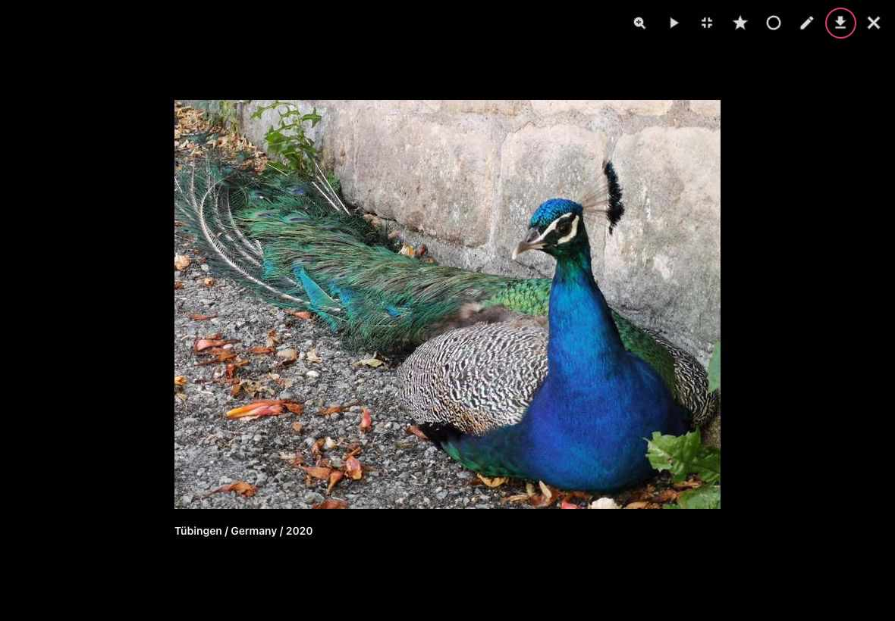
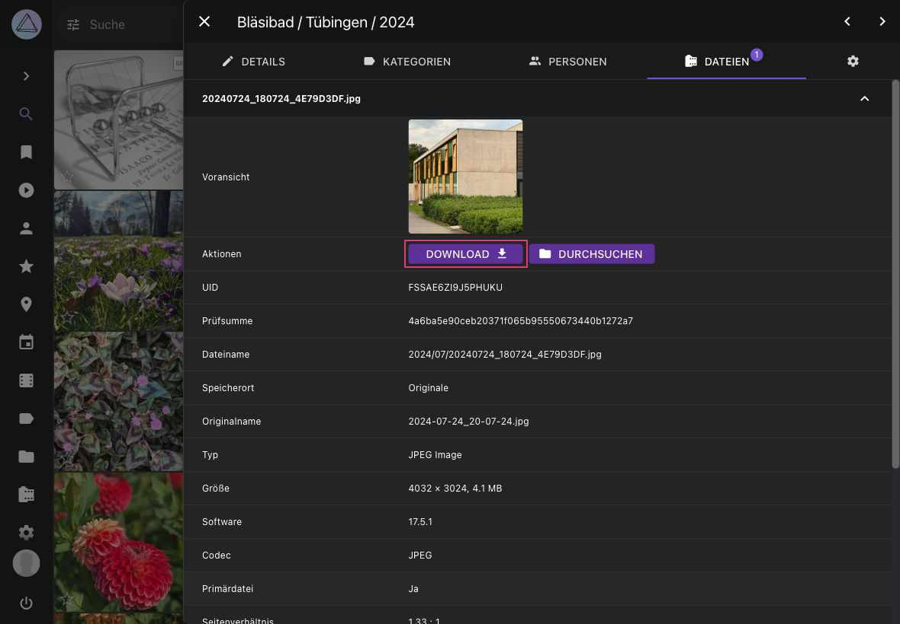

# Bilder herunterladen #

Um im Vollbild-Viewer einzelne Ausgabeformate und Bildgrößen auszuwählen, verwende den [Dialog Exportieren](export.md).

=== "Kontext-Menü"
     1. Selektiere Bilder und Videos
     2. Öffne das Kontext-Menü
     3. Klicke :material-cloud-download:

     { class="shadow" }

    !!! tip ""
        Du kannst [mehrere Bilder auf einmal selektieren](../navigate.md#auswahlmodus-und-mehrfachauswahl), indem du die Shift Taste verwendest.

    !!! info ""
        Du kannst [konfigurieren](../settings/library.md#download), welche Dateien jeweils heruntergeladen werden sollen.

=== "Vollbild-Modus"
     1. Klicke auf das Bild
     2. Im Vollbild Modus klicke :material-download:

     { class="shadow" }

    !!! info ""
        Du kannst [konfigurieren](../settings/library.md#download), welche Dateien jeweils heruntergeladen werden sollen.

    !!! tip "Tastenkombination"
        Im Vollbild-Viewer kannst du Dateien schnell herunterladen, indem du **Strg + D** drückst.
=== "Bearbeitungs-Dialog"
     1. Öffne den [*Bearbeitungs-Dialog*](edit.md)
     2. Gehe zu *Dateien*
     3. Klicke *Download*

      { class="shadow" }

## In verschiedenen Formaten und Größen exportieren { #exporting-in-different-formats-and-sizes }

Um ein Bild in einer bestimmten Größe oder einem bestimmten Format zu speichern, statt seine Originaldateien herunterzuladen, öffne es im Vollbild-Modus und wähle im Menü *Exportieren*, das direkt über *Download* steht. Alternativ kannst du **Strg + Umschalt + E** drücken.

Der Dialog listet jede Originaldatei des [Bildstapels](stacks.md) zusammen mit den dafür verfügbaren Ausgaben auf:

- **Original:** die Datei, so wie sie in deiner Bibliothek gespeichert ist.
- **Vorschau in voller Größe:** eine bereits vorhandene JPEG- oder PNG-Vorschau eines Originals, das Browser nicht als Bild anzeigen können, z. B. einer RAW-Datei.
- **JPEGs mit angepasster Größe:** auf passende Standardgrößen verkleinerte Kopien, benannt wie `IMG_0001_1920.jpg`.
- **Videos:** ein abspielbares MP4 für Videos, die nicht AVC verwenden, Animationen und Live Photos. Wurde es noch nicht erstellt, startet der Download nach dem Transkodieren.

Wähle die gewünschten Ausgaben aus und klicke *Exportieren*. Dein Browser speichert sie dann nacheinander und fragt dich deshalb möglicherweise, ob mehrere Downloads erlaubt werden sollen. Schlägt ein Download fehl, kannst du ihn im Dialog erneut versuchen.

!!! info ""
    *Exportieren* steht [Rollen](../users/roles.md) mit vollem Zugriff auf die Bibliothek zur Verfügung, z. B. *Admin* und *Benutzer*. *Betrachter*, *Gäste* und *Besucher* können Dateien herunterladen, aber nicht exportieren. Du kannst die Funktion unter [*Einstellungen > Allgemein*](../settings/general.md#exportieren) deaktivieren.
