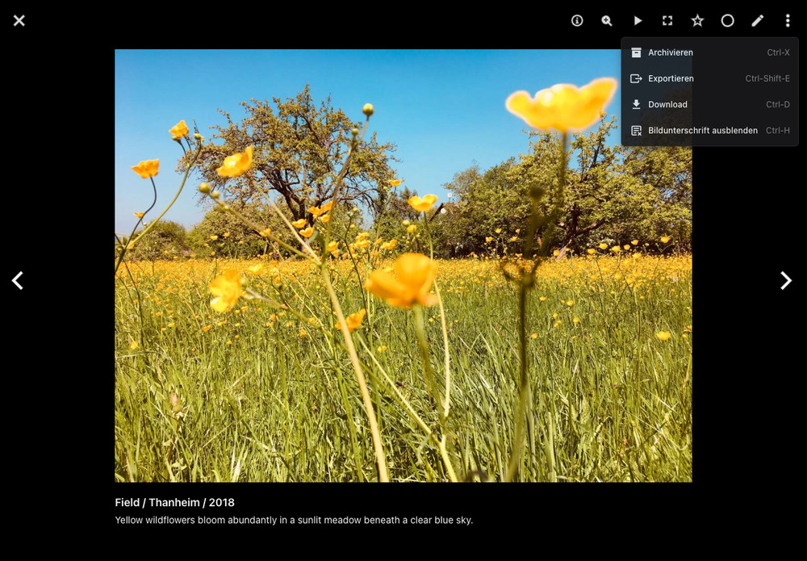
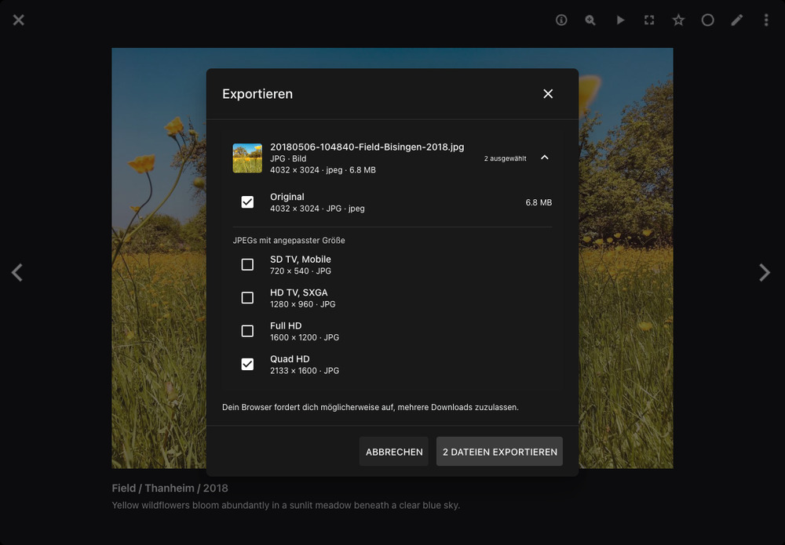

# Exportieren

Mit dem Dialog *Exportieren* speicherst du Originale, Vorschauen in voller Größe, JPEGs mit angepasster Größe oder kompatible Videos auf deinem Gerät. Du kannst dabei mehrere Versionen des Bildes oder Videos auswählen, das im [Vollbild-Viewer](../navigate.md) geöffnet ist.

## Dateien exportieren { #exporting-files }

1. Klicke auf ein Bild oder Video, um es im Vollbild-Modus zu öffnen.
2. Öffne das Menü des Viewers und wähle *Exportieren*.

    { class="shadow" }

3. Klappe eine Dateigruppe auf, um ihre Optionen zu sehen. [Bildstapel](stacks.md) können mehrere Originale enthalten, jedes mit einer eigenen Gruppe.
4. Wähle die Versionen aus, die du speichern möchtest, z. B. *Original*, *Vorschau in voller Größe* oder eine Größe unter *JPEGs mit angepasster Größe*.

    { class="shadow" }

5. Klicke *1 Datei exportieren* bzw. *N Dateien exportieren*. Erlaube mehrere Downloads, falls dein Browser danach fragt.
6. Warte, bis eine eventuelle Videokonvertierung abgeschlossen ist. Schlägt der Download einer Datei fehl, klicke daneben auf *Erneut versuchen*.

!!! tip "Tastenkombination"
    Im Vollbild-Viewer öffnest du *Exportieren* mit **Strg + Umschalt + E**, unter macOS mit **Command + Umschalt + E**.

Die Dateien werden einzeln heruntergeladen. Wenn du den Dialog schließt, werden ausstehende Exportvorgänge abgebrochen; Downloads, die dein Browser bereits gestartet hat, laufen weiter.

## Dateitypen { #file-types }

| Dateityp                                               | Verfügbare Versionen                                                                                                                                          |
|--------------------------------------------------------|---------------------------------------------------------------------------------------------------------------------------------------------------------------|
| JPEG und PNG                                           | Originaldatei und JPEGs mit angepasster Größe.                                                                                                                |
| RAW und andere Bilder, z. B. HEIC, AVIF, WebP und TIFF | Originaldatei, eine vorhandene Vorschau in voller Größe und JPEGs mit angepasster Größe.                                                                      |
| Vektorgrafiken                                         | Originaldatei, eine vorhandene Vorschau in voller Größe, meist PNG, und JPEGs mit angepasster Größe.                                                          |
| PDF-Dokumente                                          | Original-PDF, eine Vorschau der ersten Seite in voller Größe und JPEGs dieser Seite mit angepasster Größe.                                                    |
| Videos                                                 | Originalvideo, vorhandene Standbild-Vorschauen und JPEGs mit angepasster Größe sowie ein *Kompatibles Video* (MP4/H.264), wenn eine Konvertierung nötig ist.  |
| Animationen                                            | Originalanimation, vorhandene Standbild-Vorschauen und JPEGs mit angepasster Größe sowie ein kompatibles MP4-Video.                                           |
| Live Photos                                            | Originaldateien, vorhandene Standbild-Vorschauen und JPEGs mit angepasster Größe sowie ein *Videoteil*. Separate Bild- und Videodateien haben eigene Gruppen. |
| Insta360 INSV- und LRV-Videos                          | Originaldatei und vorhandene Standbild-Vorschauen. Ein kompatibles Video wird angeboten, wenn PhotoPrism es bereits konvertiert hat.                          |

Welche Vorschauen zur Auswahl stehen, hängt davon ab, welche PhotoPrism bereits erstellt hat. Erscheint *Kein Vorschaubild verfügbar.*, kannst du trotzdem das Original exportieren. Vorschauen, die als Originale gespeichert sind, haben eigene Dateigruppen.

Audiodateien, Metadaten-Dateien wie XMP, JSON und YAML sowie fehlende oder nicht lesbare Dateien werden nicht angeboten.

## Einstellungen { #settings }

### Exportieren aktivieren { #enable-export }

Administratoren können *Exportieren* unter [*Einstellungen > Allgemein*](../settings/general.md#exportieren) ein- oder ausschalten. Standardmäßig ist die Funktion aktiviert.

Der separate Schalter *Download* und die Dateiauswahl unter *Einstellungen > Inhalte > Download* gelten für die [Download-Aktionen](download.md). *Exportieren* hat einen eigenen Schalter und verwendet die Versionen, die du im Dialog auswählst.

### Statische & Dynamische Vorschaubilder { #static-dynamic-previews }

Die Einstellungen unter [*Einstellungen > Erweitert > Vorschaubilder*](../settings/advanced.md#vorschaubilder) legen fest, welche JPEG-Größen verfügbar sind:

- Sind *Dynamische Vorschaubilder* deaktiviert, sind die Größen auf die *Statische Maximalgröße* begrenzt.
- Sind *Dynamische Vorschaubilder* aktiviert, können bei Bedarf größere Vorschauen bis zur *Dynamischen Maximalgröße* erstellt werden. Diese ist immer mindestens so hoch wie die statische Maximalgröße.
- Vorschauen bis zur statischen Maximalgröße werden beim Indexieren erstellt. Größere Vorschauen können länger zum Herunterladen brauchen, weil sie erst bei Bedarf erstellt werden.

Bilder behalten ihr Seitenverhältnis und werden nie über ihre Originalgröße hinaus vergrößert. Kleinere Bilder bieten daher weniger Größen zur Auswahl.

Diese Grenzen gelten nicht für den Download von Originalen und bereits vorhandene Vorschauen in voller Größe. Letztere hängen auch von deinen [Maximalgrößen für JPEG und PNG](../settings/advanced.md#bildqualitat) ab.
