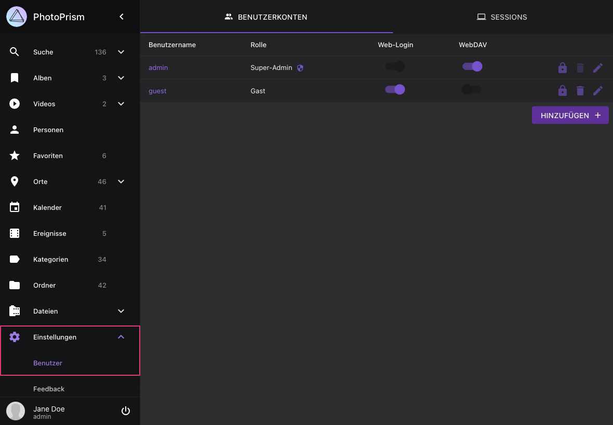
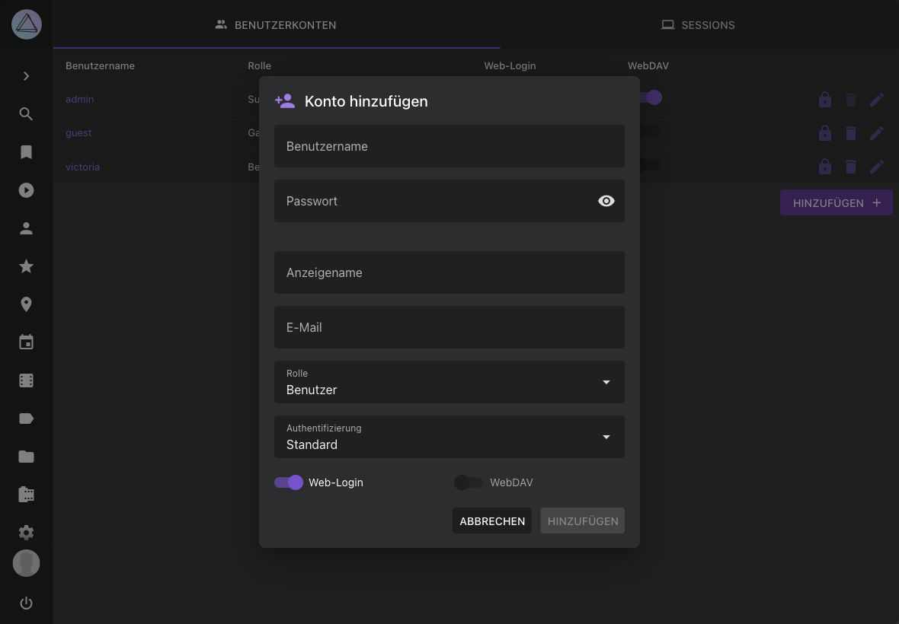
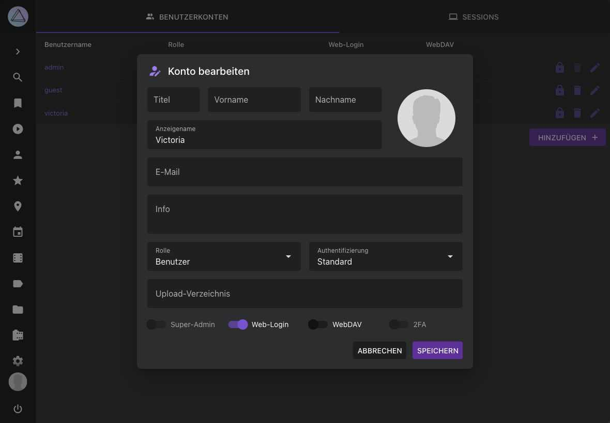
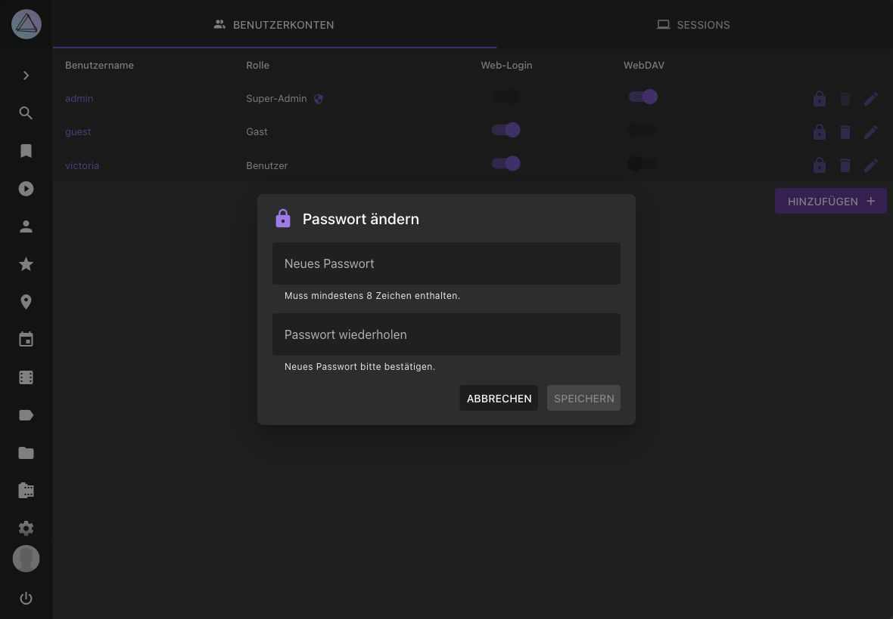
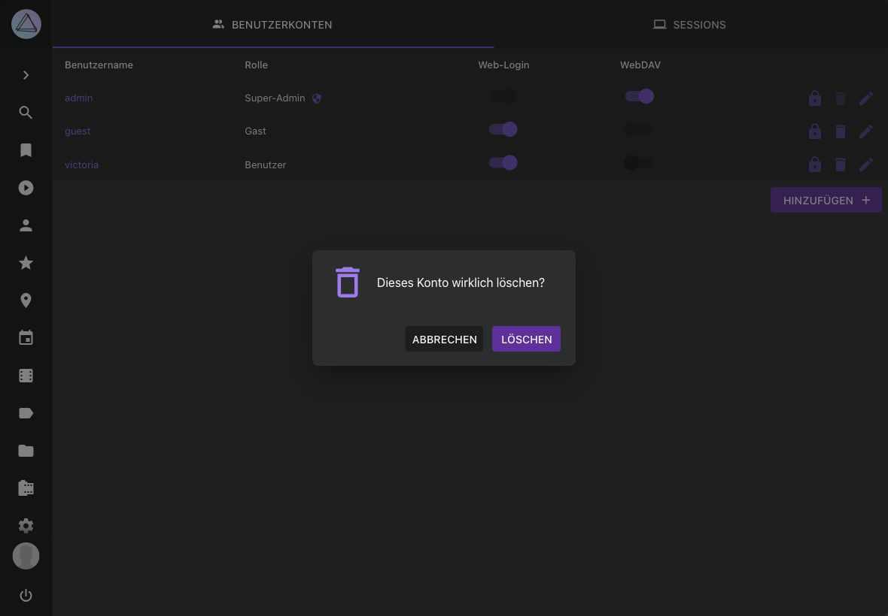
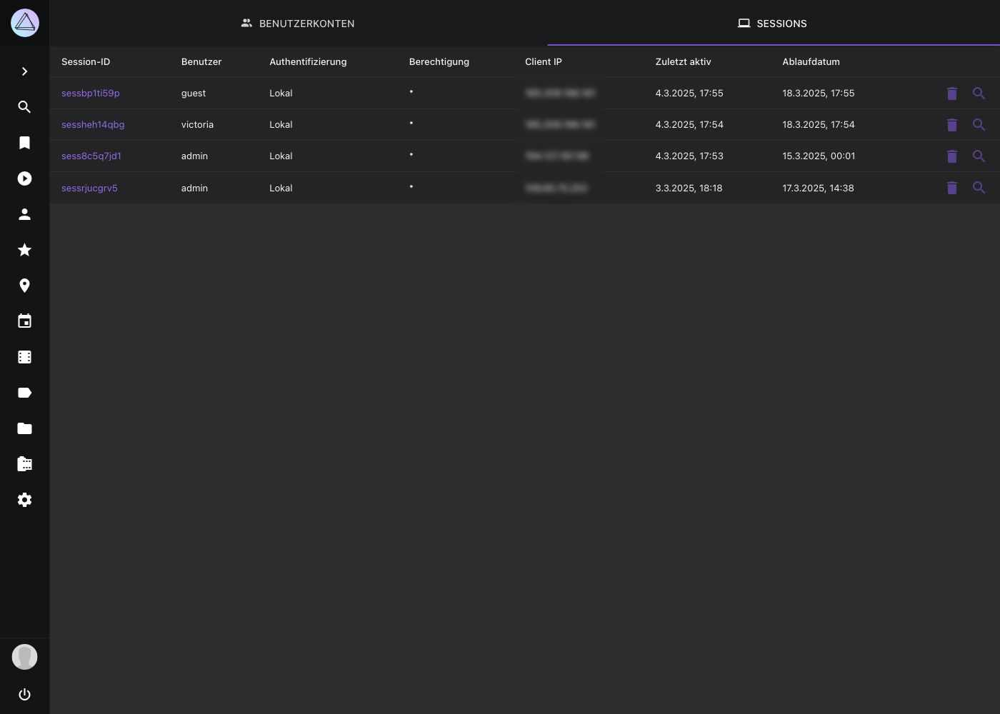

# Benutzer verwalten

!!! example ""
    [PhotoPrism® Plus](https://www.photoprism.app/editions/#compare) verfügt zusätzlich zum in allen Editionen enthaltenen [Command-Line Interface](cli.md) über ein Admin-Web-UI zum Verwalten von Nutzern und Sitzungen.
    Wenn du [PhotoPrism® Pro](https://www.photoprism.app/teams/#compare) verwendest, findest du weitere Informationen unter [Managing User Accounts](https://www.photoprism.app/pro/kb/roles/) in der Pro Knowledge Base.

Du kannst Benutzerkonten hinzufügen, bearbeiten und löschen, indem du als [Admin](roles.md#admin) zu *Einstellungen > Benutzer* navigierst:

{ class="shadow" }

## Neuen Benutzer hinzufügen

{ class="shadow" }

Benutzernamen neuer Konten dürfen nur Standard-ASCII-Zeichen enthalten, Buchstaben mit Akzenten und nicht-lateinische Schriften werden also nicht akzeptiert. Bestehende Konten behalten ihre Namen.

## Benutzer Details bearbeiten

{ class="shadow" }

Der Schalter *MCP* neben *WebDAV* legt fest, ob ein Konto über [MCP](https://docs.photoprism.app/developer-guide/api/mcp/#authorization) KI-Assistenten erlauben kann, die Bibliothek zu durchsuchen. Er ist für Rollen, die MCP verwenden dürfen, standardmäßig aktiviert und hat keine Wirkung, wenn MCP [für alle Benutzer deaktiviert](https://docs.photoprism.app/getting-started/config-options/#feature-flags) ist.

Nur [Super-Admins](roles.md#admin) können [den Authentifizierungs-Provider](cli.md#optionen) eines Kontos über die Weboberfläche ändern, ausgenommen von ihrem eigenen Konto, damit sie sich nicht versehentlich selbst aussperren, indem sie ihn z. B. auf "none" setzen.
## Passwörter ändern

Super-Admins können das Passwort eines Nutzers zurücksetzen, während normale Admins Passwörter nur ändern können, wenn sie das aktuelle Passwort kennen.

{ class="shadow" }

## Benutzer löschen

{ class="shadow" }

## Sitzungen verwalten

Du kannst aktive Sitzungen anzeigen und löschen, indem du als [Admin](roles.md#admin) zu *Einstellungen > Benutzer > Sessions* navigierst:

{ class="shadow" }

Um Sitzungsdetails anzuzeigen, klicke auf :material-magnify:.
Um eine Sitzung zu löschen klicke :material-delete:.

!!! info ""
    Wenn sich das Passwort oder die Berechtigungsstufe eines Benutzers ändert, macht PhotoPrism dessen andere aktive Sitzungen ungültig, um das Konto zu schützen.
